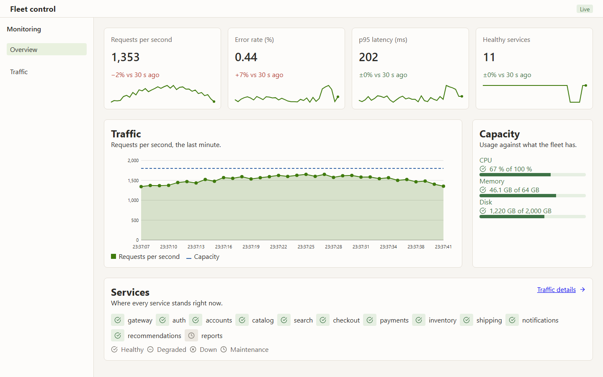
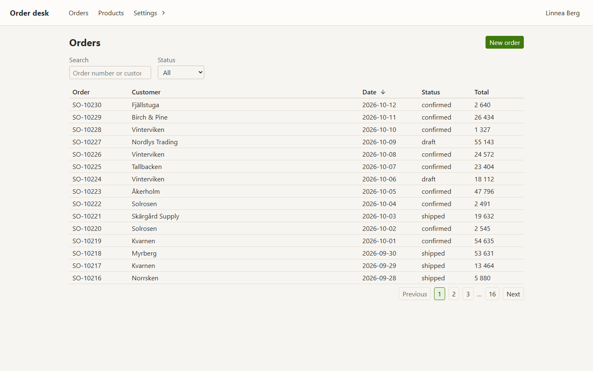
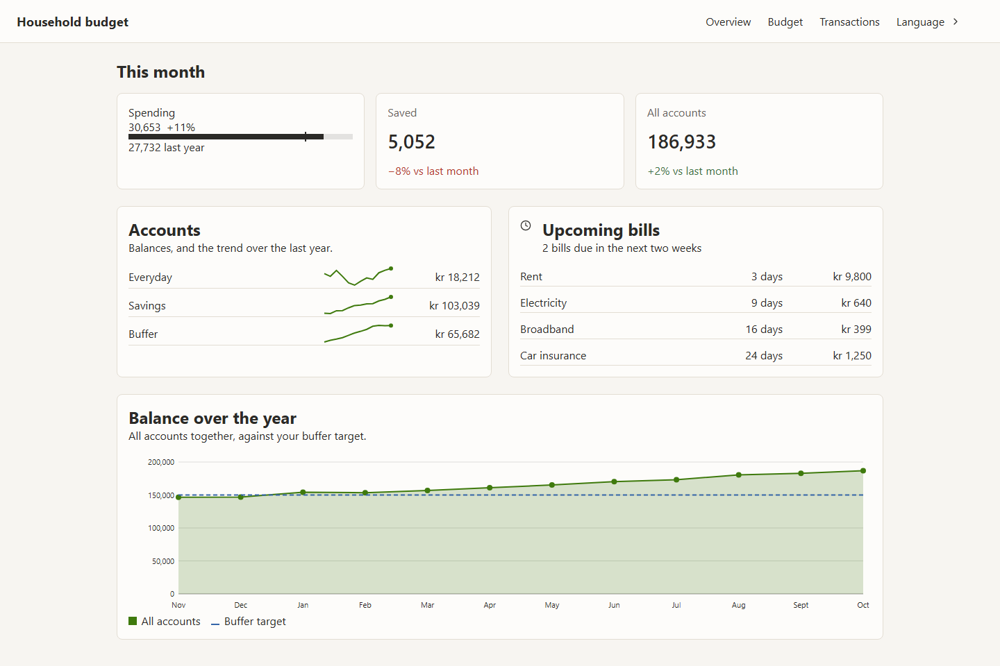
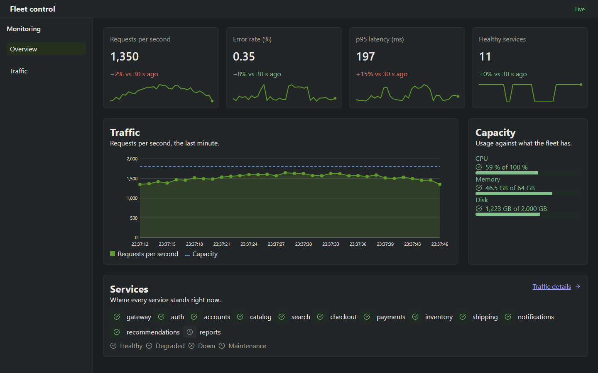
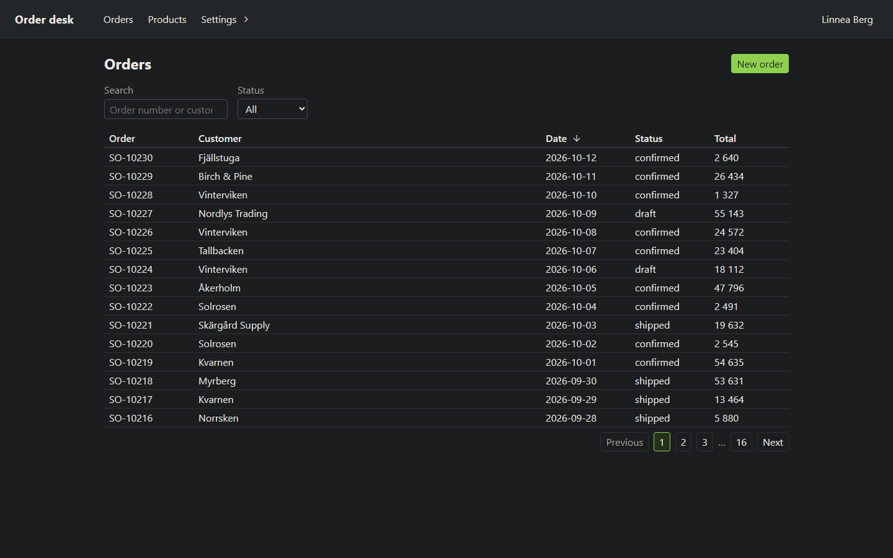
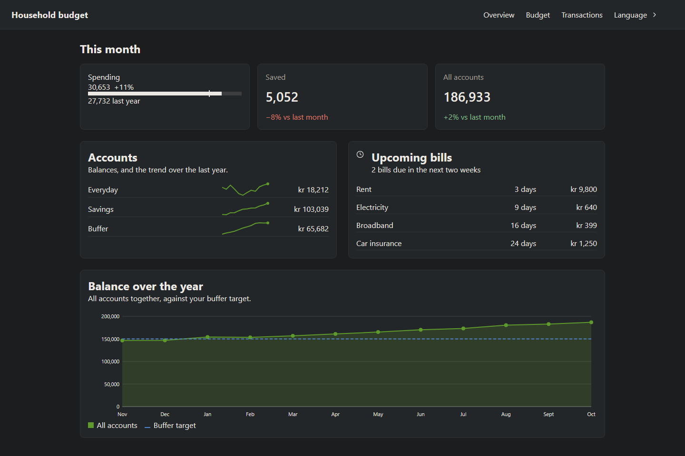

# Demos

Three small applications built with `@relax.js/components` and `@relax.js/core`, each showing a different side of the two together. They run against the components' source in `src/`, so a change there shows up in a running demo without a build. Each demo's backend runs inside the Vite dev server (`mock/`), with its data kept in memory.

| Demo | Run | Shows |
|------|-----|-------|
| [Ops dashboard](ops-dashboard) | `npm run demo:ops` (port 5301) | Live data over Server-Sent Events: stat tiles, meters, status grid, line chart and incident banners that update every second from one shared service. Plus heatmap, bar and area charts, KPI meters, and a certificate list mixing templates with days-left and status marks. |
| [Back office](back-office) | `npm run demo:office` (port 5302) | An order desk: a server-paged and sorted table with filters, an order page with tabs and an actions menu, an edit form routed into a dialog (`FormValidator` with server-side errors in the summary), a three-step new-order flow that reads order lines from a CSV in the browser, a category tree with products, and settings rows behind section navigation. |
| [Finance tracker](finance-tracker) | `npm run demo:finance` (port 5303) | English and Swedish, switched at runtime: typed copy for fixed text, ICU plurals through `t()`, and every amount, date and component word changing with the locale. Period grid, budget meters, horizontal bar chart, sparklines and a balance line chart. |

| Ops dashboard | Back office | Finance tracker |
|---------------|-------------|-----------------|
|  |  |  |
|  |  |  |

`npm run demo:screenshots` takes these again, in light and dark, after a design change. `npm run demo:check` type-checks all three. `tests/demos` checks every template against its view model and that each translation has the same keys as English.

## How they are put together

- `index.html` holds the page shell and `<r-route-target>`. Pages are created by the router after startup.
- `main.ts` imports services before components, then sets up formatting and i18n, then routing.
- Services use `@ContainerService`. Components get them with `@Inject` and never construct them.
- Widgets that show the same data watch one service rather than each other.
- `shared/demoConfig.ts` lowers decorators for the browser: Vite's dev transform otherwise leaves them in the code.
